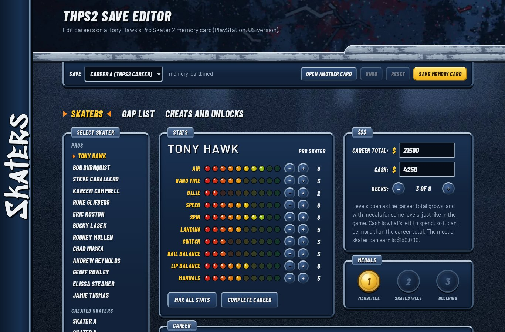
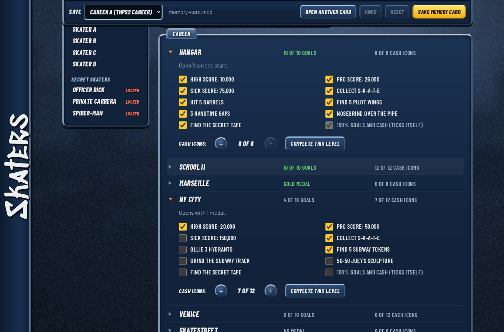
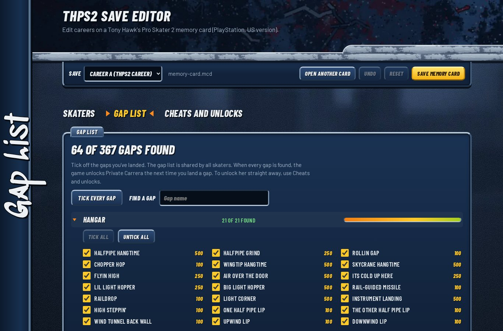
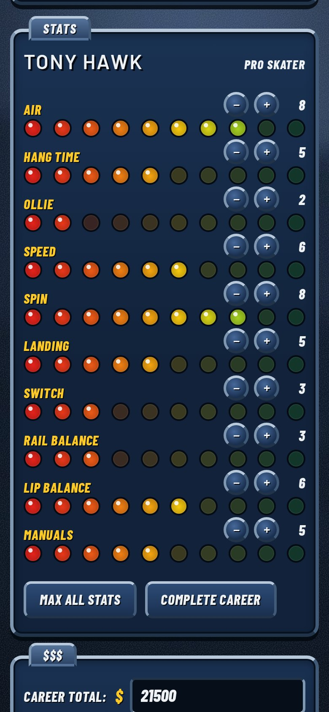

# THPS2 Save Editor

A browser-based save editor for **Tony Hawk's Pro Skater 2** on the PlayStation (US version, SLUS-01066, including the Greatest Hits release).

**Use it here:** https://shualyons.github.io/thps2-save-editor/

## What you can edit

**Each skater**: all 13 pros, the 4 created skaters, Officer Dick, Private Carrera and Spider-Man.

- Cash and career total
- All 10 stats
- Decks unlocked
- Every goal on every level, gold medals, and cash icons collected
- One-click "Complete career" and "Max all stats"

**Shared by all skaters**

- The gap list: tick off any of the 367 gaps by name, with its points, or tick a whole level at once. A search box finds a gap by name.
- Secret skaters: McSqueeb, Spider-Man, Officer Dick and Private Carrera
- Secret levels: Chopper Drop and Skate Heaven
- All 14 cheats

The editor keeps the game's own bookkeeping in step, so it can't create a career the game couldn't. For example, "100% goals and cash" ticks itself only when every other goal and cash icon in that level is done, and cash can never be more than the career total.

There's also undo, reset, and a warning if you try to leave with unsaved changes.

## How to use it

1. In the game, save your career to the memory card.
2. Close your emulator, then make a copy of your memory card file as a backup.
3. Open the editor and choose your memory card file (.mcd, .mcr, .mc, .srm or .gme).
4. Make your changes, then select **Save memory card**. Your browser downloads a new copy with the same name.
5. Put the new file in your emulator's memory card folder in place of the old one. Start the game and load your career.

## Before you start

- Load your career from the memory card, not from an emulator save state. Save states aren't read by the editor, and loading an old one can overwrite your edited card.
- Keep a backup of your memory card file.
- Don't use edited saves for RetroAchievements or competitive runs.
- Only the US version is supported. European and Japanese saves are recognised and refused with a message.
- Everything happens in your browser. Your memory card isn't uploaded anywhere.

## How it was tested

THPS2 career saves have no checksum, so the game can't tell an edited save from a normal one. That makes loading edited saves in the game the real test. Every feature was checked in DuckStation:

- cash, career total and stats
- goals (the goal order was confirmed in the Hangar; the other levels follow StrategyWiki's goal lists), gold medals, cash icons and decks
- the gap list, cheats, secret skaters and secret levels

The gap names and their order come from the PC version's gap table (see Credits). The number of gaps matches the PS1 save for every level, and a real first Hangar run found the first two gaps on the list, both on the halfpipe. The order hasn't yet been checked gap by gap in the PS1 game.

The editor was also tested against real memory cards (including a 100% save), with 20,000 random edits, damaged and malformed files, and attempts to inject script code through save and skater names.

## Security

- One self-contained file. Nothing is loaded from other sites, and it makes no network requests.
- A strict Content Security Policy with a SHA-256 hash of the page's script, so the browser refuses to run any script that isn't exactly this one.
- Names read from memory cards are always shown as plain text.

## Save format notes

For anyone researching THPS2 saves. Offsets are from the start of the save (the 8 KB block with the `SC` header). Values are little-endian.

| What | Where |
| --- | --- |
| Format marker | `0x200`: `00 28 07 00` in every career save seen |
| Skater records | `0x204`, 20 records of `0xE4` bytes, in select-screen order (13 pros, 4 created skaters, Officer Dick, Private Carrera, Spider-Man) |
| In each record | `+0x00` goals ticked (byte), `+0x03` gold medals (byte), `+0x04` career total, `+0x08` cash, `+0x0C` goals per level (16-bit, 10 levels), `+0x2C` decks (bit mask), `+0x30` 10 stats, `+0x3C` cash icons per level (8 bytes each) |
| Goal bits | Bits 0 to 9 follow the level's goal list (bit 9 is "100% goals and cash"). Competitions: `0x0400` gold, `0x1C00` any medal, `0x8000` all cash icons |
| Gap list | `0x1694`, 12 bytes per level, shared by all skaters. A gap's bit is its position among that level's gaps in the game's gap table |
| Cheats | `0x17A8`, 17 entries of 4 bytes: unlocked, skater, state, padding |
| Created skater names | `0x18BC`, every `0x80` bytes |
| Unlock flags | `0x1AC0`: `0x04` Private Carrera, `0x3B` Chopper Drop and Skate Heaven |

There's no checksum. Levels open from the career total and medals rather than stored flags.

## Credits

- Memory card layout: [thps2-demo-decomp](https://github.com/emoluvjd2/thps2-demo-decomp) by emoluvjd2
- Career data notes: [THPS2 Cumulative Patch](https://github.com/DCxDemo/THPS2-Cumulative-Patch) by DCxDemo
- Skater order and memory layout clues: community GameShark code lists
- Goal lists and level requirements: [StrategyWiki](https://strategywiki.org/wiki/Tony_Hawk%27s_Pro_Skater_2)
- Gap names, points and order: the THPS2 gap table in DCxDemo's [THPS2 Cumulative Patch](https://github.com/DCxDemo/THPS2-Cumulative-Patch)
- Reference values for a finished career: a 100% save shared on GameFAQs
- Fonts: Barlow and Barlow Condensed by the Barlow Project Authors, and Sedgwick Ave Display by the Sedgwick Ave Project Authors, under the SIL Open Font License (see [OFL.txt](OFL.txt))
- The background textures (the blurred skate spot, steel bars and spray-paint strips) are original, generated by code. No game artwork is included.
- Built with help from Claude, an AI assistant made by Anthropic

Only facts (offsets, formats, names and numbers) were taken from these sources. No code was copied.

## License

The code is MIT licensed (see [LICENSE](LICENSE)). The built-in fonts are under the SIL Open Font License (see [OFL.txt](OFL.txt)).

Not affiliated with or endorsed by Activision or Neversoft. Tony Hawk's Pro Skater is a trademark of Activision.
